  <!-- ENCABEZADO ANIMADO (TYPING SVG) -->
  

  <!-- ANIMACIÓN MINIMALISTA DE MOTO CORRIENDO -->
  

    
  

  <!-- BADGES DE ESTADO MINIMALISTAS -->
  

    
    
    
  

---

### ⚡ Sobre mí

Soy **Jordan Stewart Zabala Correa**, apasionado por la tecnología, la **Ciencia de Datos y la Inteligencia Artificial**. Fuera del código me apasiona el mundo de las **motos** 🏍️, y llevo esa misma filosofía al desarrollo: **precisión, rendimiento limpio y mejora continua**.

- 🧠 **Enfoque actual:** Ciencia de Datos, Inteligencia Artificial y automatización con **Python**.
- 📊 **Proyecto reciente:** [Métricas TI (`TI-Metrics`)](https://github.com/Stewart-Zabala-TI/TI-Metrics) — *Motor de Analítica de Logs y Monitoreo de Infraestructura*.
- 🎯 **Objetivo:** Construir modelos inteligentes y soluciones basadas en datos con una arquitectura minimalista y eficiente.

---

### 🛠️ Lenguaje Principal y Entorno

  
  
  
  

---

### 📈 Lenguaje Más Usado y Actividad en GitHub

  
  

  

---

### 🌐 Redes de Contacto

<!-- 👇 REEMPLAZA LOS ENLACES "https://..." CON TUS PERFILES REALES 👇 -->

  <!-- Correo (Ya configurado con tu Gmail) -->
  

  <!-- LinkedIn -->
  

  <!-- Instagram -->
  

  <!-- Facebook -->
  

  <!-- WhatsApp -->
  

  <!-- X / Twitter -->
  

  <!-- Discord -->
  

  <!-- TikTok -->
  

 

  ⚡ <i>"Código limpio, datos precisos y siempre a máxima velocidad."</i> 🏍️

