  <!-- ===================================================================== -->
  <!-- 1. ENCABEZADO ANIMADO + HERO SUPERBIKE & TELEMETRÍA IA                -->
  <!-- ===================================================================== -->
  

  <!-- ESCENA PRINCIPAL ANIMADA: SUPERBIKE + TACÓMETRO RPM + RED NEURONAL -->
  

    
  

  <!-- INSIGNIAS SUPERIORES DE ESTADO -->
  

    
    
    
    
  

<!-- SEPARADOR LÁSER ANIMADO -->

  

<!-- ===================================================================== -->
<!-- 2. BENTO GRID ANIMADO: SOBRE MÍ, RED NEURONAL & MOTOR PYTHON          -->
<!-- ===================================================================== -->

  

<!-- SEPARADOR LÁSER ANIMADO -->

  

<!-- ===================================================================== -->
<!-- 3. PROYECTO DESTACADO (CLICKABLE INTERACTIVE CARD)                    -->
<!-- ===================================================================== -->
<h3 align="center">🚀 Proyecto Destacado en Producción</h3>

  

<!-- SEPARADOR LÁSER ANIMADO -->

  

<!-- ===================================================================== -->
<!-- 4. ARSENAL TECNOLÓGICO & ECOSISTEMA DE DATOS                          -->
<!-- ===================================================================== -->
<h3 align="center">🛠️ Lenguaje Principal &amp; Ecosistema de Ciencia de Datos</h3>

  <!-- Iconos modernos de alto impacto -->
  

    
  

  <!-- Badges minimalistas de tecnologías y enfoque -->
  

    
    
    
    
    
    
  

<!-- SEPARADOR LÁSER ANIMADO -->

  

<!-- ===================================================================== -->
<!-- 5. TELEMETRÍA DE GITHUB & LENGUAJE MÁS USADO                          -->
<!-- ===================================================================== -->
<h3 align="center">📊 Telemetría de GitHub &amp; Lenguaje Más Usado</h3>

  
  

  

  

<!-- SEPARADOR LÁSER ANIMADO -->

  

<!-- ===================================================================== -->
<!-- 6. REDES DE CONTACTO (LISTAS PARA PERSONALIZAR)                       -->
<!-- ===================================================================== -->
<h3 align="center">🌐 Conecta Conmigo</h3>

<!-- 👇 REEMPLAZA "TU_USUARIO_AQUI" CON TUS ENLACES REALES 👇 -->

  
  
  
  
  
  
  
  

 

<!-- FOOTER ANIMADO -->

  

