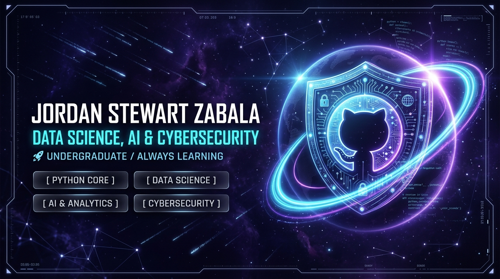
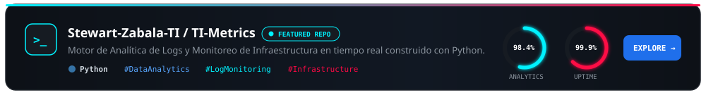
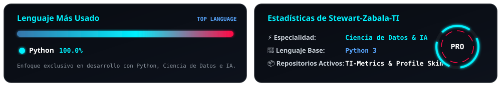
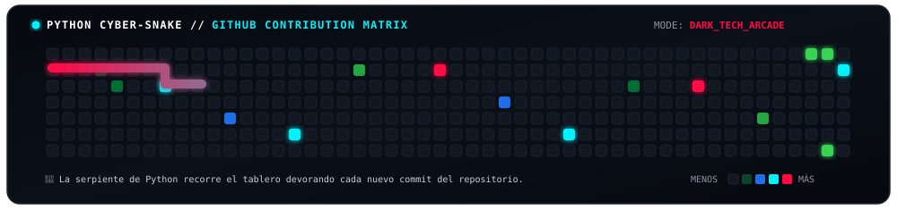

  <!-- ===================================================================== -->
  <!-- 1. BANNER PRINCIPAL: COSMIC CYBERSECURITY, DATA SCIENCE & AI (8K)     -->
  <!-- ===================================================================== -->
  

    
  

  <!-- ENCABEZADO ANIMADO (TYPING SVG) -->
  

  <!-- INSIGNIAS SUPERIORES DE ESTADO -->
  

    
    
    
    
  

<!-- SEPARADOR LÁSER ANIMADO -->

  

<!-- ===================================================================== -->
<!-- 2. BENTO GRID ANIMADO: SOBRE MÍ, RED NEURONAL & MOTOR PYTHON          -->
<!-- ===================================================================== -->

  

<!-- SEPARADOR LÁSER ANIMADO -->

  

<!-- ===================================================================== -->
<!-- 3. LENGUAJE PRINCIPAL & TERMINAL DARK TECH (100% HONEST PYTHON FOCUS) -->
<!-- ===================================================================== -->
<h3 align="center">🐍 Lenguaje Principal &amp; Ruta de Aprendizaje</h3>

  

  

    
  

<!-- SEPARADOR LÁSER ANIMADO -->

  

<!-- ===================================================================== -->
<!-- 4. PROYECTO DESTACADO (CLICKABLE INTERACTIVE CARD)                    -->
<!-- ===================================================================== -->
<h3 align="center">🚀 Proyecto Destacado</h3>

  

<!-- SEPARADOR LÁSER ANIMADO -->

  

<!-- ===================================================================== -->
<!-- 5. LENGUAJE MÁS USADO & MINIJUEGO DE LA SERPIENTE (CONTRIBUCIONES)    -->
<!-- ===================================================================== -->
<h3 align="center">📊 Lenguaje Más Usado &amp; Matriz de Contribuciones</h3>

  

 

  <!-- Minijuego de la Serpiente Cyber-Python cazando commits -->
  

  

<!-- SEPARADOR LÁSER ANIMADO -->

  

<!-- ===================================================================== -->
<!-- 6. REDES DE CONTACTO (LISTAS PARA PERSONALIZAR)                       -->
<!-- ===================================================================== -->
<h3 align="center">🌐 Conecta Conmigo</h3>

<!-- 👇 REEMPLAZA "TU_USUARIO_AQUI" CON TUS ENLACES REALES 👇 -->

  
  
  
  
  
  
  
  

 

<!-- FOOTER ANIMADO -->

  

