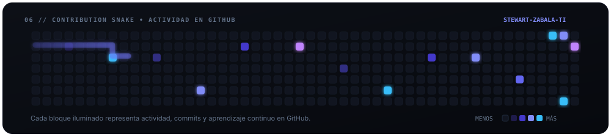

  <!-- ===================================================================== -->
  <!-- 01. HERO BANNER: STEALTH TITANIUM & ELECTRIC ICE BLUE (ANIMADO)       -->
  <!-- ===================================================================== -->
  

  

<!-- ===================================================================== -->
<!-- 02. SOBRE MÍ & HOLOGRAMAS DE DATOS (BENTO TITANIO OSCURO)             -->
<!-- ===================================================================== -->

  

  

<!-- ===================================================================== -->
<!-- 03. PANEL EXCLUSIVO DE PYTHON & RUTA DE APRENDIZAJE                   -->
<!-- ===================================================================== -->

  

  

<!-- ===================================================================== -->
<!-- 04 & 05. PROYECTO DESTACADO (TI-METRICS) & LENGUAJE MÁS USADO         -->
<!-- ===================================================================== -->

  

  

<!-- ===================================================================== -->
<!-- 06. MINIJUEGO DE LA SERPIENTE EN LAS CONTRIBUCIONES                   -->
<!-- ===================================================================== -->

  

  

<!-- ===================================================================== -->
<!-- 07. REDES DE CONTACTO (ENLACES REALES ACTIVOS)                        -->
<!-- ===================================================================== -->

  

    
    
    
    
    
  

  <!-- Contador sutil de visitas en Azul Cobalto -->
  

    
  

<!-- PIE DE PÁGINA TITANIO & AZUL ELÉCTRICO -->

  

